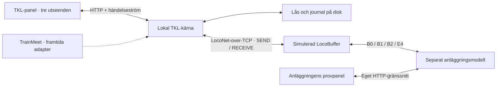

# Arkitektur

TKL-kärnan importerar inte simulatorn, läser inte dess driftdata och anropar inte dess HTTP-gränssnitt. Endast dess konfigurerade LocoNet-adresser och telegram används. Samma parser och tågvägslogik ska senare kunna användas med en riktig gateway. En faktisk seriell adapter återstår att implementera.

`profiles/charlottendal.json` och `profiles/simulator.json` är statiska konfigurationer som genereras från samma adressunderlag. De är inte delat drifttillstånd. Katalogen i simulatorn beskriver bara fördefinierade detektorföljder för tåg; inga TKL-tågvägs-ID:n överförs på bussen.

## Tågvägens livscykel

1. Kontrollera aktuella fria detektorer, stoppbesked samt konflikter med kvarvarande lås.
2. Spara reservationerna innan växelorder skickas.
3. Vänta på rätt rapporterade växellägen; eko på B0 räcker inte. Växlar som delas i samma läge manövreras inte om.
4. Visa flödet genom den etablerade vägen. Det är en presentation på 1,2 sekunder; alla villkor kontrolleras även under denna tid.
5. Begär kör från sista signalen bakåt och invänta varje signals faktiska besked. Rapportkod kan fortfarande vara stopp trots begärt kör.
6. Vid beläggning eller fel begärs stopp och reservationerna ligger kvar. Provversionen har ingen automatisk sektionsvis upplåsning.
7. Återtagning inväntar fria avsnitt, aktuella kända växellägen och stopp på relevanta signaler innan låsen släpps. Ny körning kräver ny beställning.

Rapporter äldre än sju sekunder blir okända. Simulatorn upprepar rapporter varannan sekund. En fysisk adapter behöver en verifierad metod för initial synkronisering och aktualitetskontroll; periodiska rapporter kan inte antas från verklig utrustning.

## Filer

| Del | Ansvar |
|---|---|
| `src/engine.mjs` | Tågvägar, reservationer, tillstånd och kommandon |
| `src/protocol.mjs` | Telegram, kontrollsummor och strömavkodning |
| `src/transport.mjs` | LocoNet-over-TCP, kvittenser och återanslutning |
| `src/server.mjs` | Lokal API-server och händelseström till panelen |
| `src/storage.mjs` | Atomisk filersättning och journal |
| `src/field.mjs`, `src/simulator.mjs` | Oberoende anläggning och buffert |
| `src/topology.mjs` | Importerad graf, växelkopplingar och sökning |
| `public/` | Panel, tre utseenden, simulatorpanel, tillgångar och originaldata |

Ingen extern JavaScript-kod eller font laddas. HTTP-servrarna lyssnar endast lokalt och kontrollerar Host/Origin samt JSON för ändrande anrop. Lokal körning behöver ingen inloggning. Webbdriften har lösenordsskydd och systemtjänster enligt driftbeskrivningen. Det kompletta XML-registret är skrivskyddat och laddas vid behov; det driver inte automatiskt förreglingskärnan.
