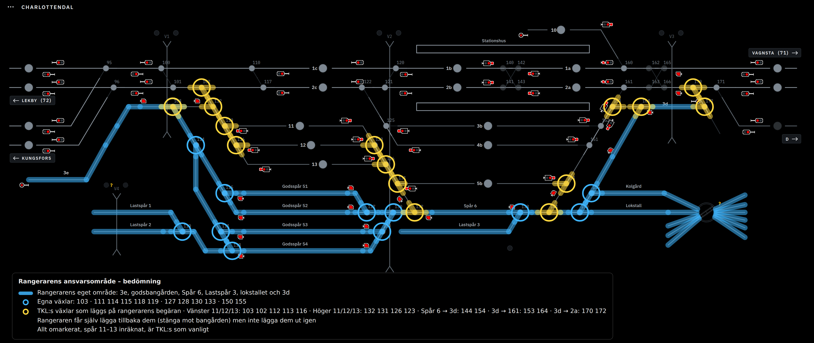

# Rangerarläget

Beslutat med anläggningsägaren 6 oktober 2026. Ersätter modellen i
[rangerbangard-overlamning.md](rangerbangard-overlamning.md): inget spår byter
ägare längre. Rangeraren har ett eget område, och allt annat är TKL:s. Det som
förbinder dem är **begäran**: rangeraren trycker på en knapp, TKL godkänner, och
ställverket lägger växlarna.

## Områden

**Rangerarens eget område (blått).** 3e med nedfarten till 103, godsbangården
(Godsspår 51–54, Lastspår 1–2), Spår 6 och Lastspår 3, lokstallsområdet med
Kolgård, Lokstall och vändskivan, samt 3d. Egna växlar som rangeraren lägger
fritt: **103 · 111 114 115 118 119 · 127 128 130 133 · 150 155**. 3e är
rangerarens utdragsspår: vägen från godsbangården till 11–13 går via 103 till 3e
och tillbaka.

**TKL:s område (omarkerat).** Allt annat, spår 11–13 inräknade. Rangeraren äger
aldrig 11–13; de är TKL:s spår som rangeraren får komma in på efter begäran.

**Växlar som läggs på begäran (gult).** TKL:s växlar, plus rangerarens
grindväxlar (103, 132, 144, 164), som en begäran lägger som grupp. Rangeraren
rör dem bara i "tillbaka"-riktningen (nedan).

## Begäran

Varje begäran är en fördefinierad växelgrupp. Lägena är hämtade ur profilens
växeltågvägar (`kind: shunt`) och huvudtågvägar; 102 är skyddsväxel utan egen
växeltågväg.

| Begäran | Växlar som läggs (ut-läge) | Växeltågväg i profilen |
|---|---|---|
| Vänster 11 | 103 C · 102 C · 112 T · 113 T | 3/1 → 3/5 |
| Vänster 12 | 103 C · 102 C · 112 T · 113 C · 116 T | 3/1 → 4/5 |
| Vänster 13 | 103 C · 102 C · 112 T · 113 C · 116 C | 3/1 → 5/5 |
| Höger 11 | 132 T · 131 T · 126 C · 123 C | 6/6 → 3/10 |
| Höger 12 | 132 T · 131 T · 126 C · 123 T | 6/6 → 4/10 |
| Höger 13 | 132 T · 131 T · 126 T | 6/6 → 5/10 |
| Spår 6 ut via 154 | 144 T · 154 T | 6/7 → 6/9, vidare 6/9 → 3/11 |
| 3d ut åt vänster | 164 C · 153 C · 161 C | 3/2 → 3/6 |
| 3d ut åt höger | 172 mot 170 · 170 T | saknas – läggs till |

Namnen på de tre sista är förslag; de visas som knappar i rangerarens vy och kan
döpas om i profilen.

### Envägsregeln

En godkänd begäran lägger gruppen i ut-läge och ger rangeraren rätt att **lägga
tillbaka** den: gruppens växlar går till sina tillbaka-lägen (103 T, 112 C,
113/116 enligt TKL:s normalläge, 132 C, 131 C, 144 C, 154 C, 164 T …) så att
förbindelsen mot TKL stängs och TKL får sina spår fria utan att göra något.
Rangeraren kan aldrig lägga gruppen **ut** själv; det kräver en ny begäran som TKL
godkänner. Tillbaka-läget är samtidigt det läge rangeraren använder internt
(103 T mellan 3e och bangården, 132 C och 144 C längs Spår 6, 164 T mellan 3d och
lokstallet), så den egna trafiken störs inte av regeln.

Typiskt förlopp: rangeraren begär Höger 11, TKL godkänner, gruppen läggs,
rangeraren kör ut på 11, hämtar vagnarna och kör tillbaka in, lägger tillbaka.
Grupperna är lästa ur profilen, så fler eller ändrade grupper är en
konfigurationsändring, inte en kodändring.

### Flödet

1. Rangeraren trycker på en knapp i sin vy. Ställverket kontrollerar först det
   som inte kan gå: ligger en huvudtågväg eller växeltågväg över någon växel i
   gruppen, är en växel i gruppen låst eller belagd, eller har gruppen redan en
   öppen begäran, får rangeraren svaret direkt i sin statusrad ("Går inte att
   lägga: tågväg 2c → 11 ligger") och **ingen begäran skickas till TKL**.
2. Annars blir begäran öppen. I TKL:s vy lyser gruppens växlar gult, som på
   bilden, och i Drift-fliken visas begäran med **Godkänn** och **Neka**. Status-
   raden visar att en begäran väntar.
3. Godkänn lägger gruppen med samma kontroller som en manuell växling, och
   rangeraren får beskedet "Höger 11 lagd". Neka ger "Höger 11 nekad" med TKL:s
   eventuella ord. Begäran journalförs i båda rollerna.
4. Gruppen ligger ute tills rangeraren lägger tillbaka. Under tiden är gruppens
   växlar låsta för TKL:s manuella manövrer, och tågvägar som behöver dem i ett
   annat läge avvisas med orsak "ligger ute för rangeraren".
5. Lägg tillbaka lägger tillbaka-lägena och avslutar rätten. TKL kan också dra
   tillbaka en godkänd grupp (med samma spår- och signalvillkor) om rangeraren
   inte svarar.

### Växeltågvägar

Alla dvärgar och huvuddvärgar inom rangerarens område – hela vägen ut till
stoppbockarna – ingår i växeltågvägarna. Rangeraren lägger växeltågvägar fritt
mellan signaler i det egna området. När en begäran är godkänd får rangeraren
även lägga växeltågvägar **från spår 11–13 in i det egna området**, till exempel
från 3/10 (11, högra änden) hela vägen till lokstallet som en kedja av
växeltågvägar (6/6 → 3/10 vänd, 6/7 → 6/11), eller från vänster in till
stoppsignalen vid 3e. Det är frivilligt: rangeraren får också köra på lagd grupp
utan växeltågväg.

TKL lägger som förut växeltågvägar mellan alla signaler i sitt område. Profilen
har i dag 130 växeltågvägar, varav 112 berör rangerområdets signaler; de som
saknas (3d ut åt höger via 172/170 och eventuella luckor mot stoppbockarna) läggs
till i profilen i steg 1.

## Byggsteg

1. **Konfiguration och kärna** – klart i 0.62.0. `rangerRequests` i profilen
   (`src/ranger-requests.mjs`: åtta grupper med ut- och tillbaka-lägen ur
   växeltågvägarna), `yardBoundaries` utökat till alla åtta gränsväxlar med
   tillbaka-läget som rangerarens enda läge, och `yardArea` med de elva egna
   växlarna (103 är gränsväxel: tillbaka-läget T mot bangården lägger
   rangeraren fritt). Begäranobjektet i `src/yard-control.mjs`
   (öppen → lagd → tillbaka, eller nekad), kontrollerna i steg 1 i flödet,
   låsning mot TKL:s manövrer och tågvägar, journalraderna `ranger-request`,
   `ranger-approved`, `ranger-denied`, `ranger-returned` och
   `ranger-withdrawn`, API:t `/api/ranger/request|answer|return|withdraw`
   och Stream Deck-knappen Rangerbegäran (kort tryck godkänner, långt nekar).
   Den gamla knappen **Lämna över rangerbangården** är borta. 3d ut åt höger
   väntar på provkörningen (172:s koppling i panelen).
2. **TKL:s vy** – klart i 0.63.0. Gruppens växlar blinkar gult i spårplanen
   medan begäran väntar och lyser gult medan den ligger ute
   (`public/ranger-notice.js`). Statusraden bredvid CHARLOTTENDAL visar
   "Rangeraren begär Höger 11" med Godkänn och Neka, sedan "Höger 11 ligger
   ute för rangeraren" med Dra tillbaka – inga flikar, ett klick, som fri-
   knapparna på originalpanelen. Händelsekolumnen visar begäran, svar och
   tillbakaläggning.
3. **Rangerarens vy.** `#ranger` i samma app med egen spårplan över det egna
   området, de nio knapparna, svar i statusraden, Lägg tillbaka, egna växlar
   och växeltågvägar mellan egna signaler samt från 11–13 när gruppen ligger.
   Serverbestämd rangerroll (ingen HTTP-order från rangerarens vy kan nå TKL:s
   växlar).
4. **Driftsättning.** Rangerarens vy via webbdriften och via Pi:ns nätverk,
   inloggning för rangeraren, och Stream Deck-knappar för de nio begäran.

## Öppna frågor

- 3d ut åt höger: 172 har ingen växeltågväg i profilen och dess andra ben går
  till en stoppbock i panelen. Läget mot 170 verifieras vid provkörning.
- Om TKL ska kunna neka med ett ord ("vänta, tåg 71 kommer") eller bara Neka.
- Om en begäran ska förfalla av sig själv om TKL inte svarar inom en viss tid.
