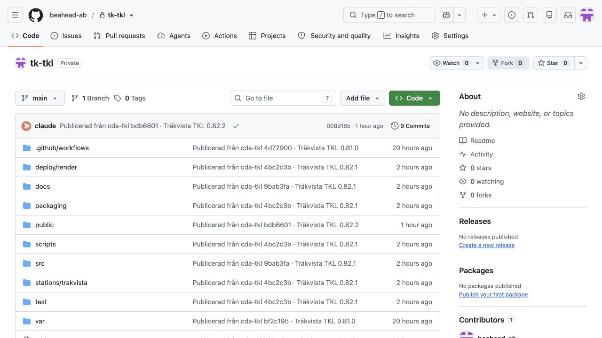

# Flera stationer: Charlottendal och Träkvista

17 oktober 2026. Hur Charlottendal och Träkvista delar program men hålls isär, hur Träkvistas förråd publiceras och hur
rättelser därifrån kommer tillbaka. Träkvistas eget läge står i [Träkvista TKL](trakvista.md), förstudien i
[Träkvista och flera stationer](trakvista-forstudie.md).

## Två förråd, ett program

| | cda-tkl (privat) | tk-tkl (privat) |
|---|---|---|
| Innehåll | Programmet, Charlottendal och Träkvista, arbetsjournalen, driftsättningen, hela historiken | Programmet och Träkvista, inget mer |
| Utvecklas | Här: programmet och båda stationernas källor | Publiceras härifrån, en commit per publicering |
| Installeras från | `beahead-ab/cda-tkl-install` (publikt, `deploy/publish-install.sh`) | `beahead-ab/Tk-TKL` själv |
| Benny | Har inte tillgång | Kan få tillgång |

Programmet är detsamma i båda. En rättelse i kärnan görs i cda-tkl och provas där mot båda stationerna
(`test/trakvista.test.mjs` kör Träkvistas 57 tågvägar), och når Träkvista vid nästa publicering. Charlottendals data
(`profiles/`, `public/data/` med Cda60.xml), dess generatorer och de prov som läser dess filer följer aldrig med till
Tk-TKL; inte heller dokumenten utom de som `installation.docs` i `stations/trakvista/station.json` räknar upp.

## Publicera Tk-TKL

```sh
deploy/publish-station.sh trakvista          # programmet och Träkvista ur HEAD till beahead-ab/Tk-TKL
```

Skriptet bygger paketet ur en commit i cda-tkl (aldrig ur arbetsträdet), ger det Träkvistas identitet
(`scripts/make-station-repository.mjs`: tk-tkl, README ur `stations/trakvista/README.md`), kör proven i paketet och
pushar en commit, *Publicerad från cda-tkl <commit> · Träkvista TKL <version>*. En Pi med Träkvista hämtar den med
`sudo tk-tkl-update`. Första gången ersattes Tk-TKL:s historik med `--first`.

Paketet får också `.github/workflows/prov.yml` (ur `packaging/github/station-tests.yml`): GitHub kör proven och
`npm run verify:trakvista` på varje pull request i Tk-TKL. Skyddas main så att ändringar måste gå via pull request
(Settings → Branches), behöver ägaren och Claudes GitHub-app stå som undantag, annars stoppas publiceringens push.

## Webbdrift för en station på Render

Paketet får också `render.yaml` och `Dockerfile.render` (ur `packaging/render/`), så att stationen kan köras på Render
som en ny installation: Render → New → Blueprint och förrådet. Gatewayen (`deploy/render/start.mjs`) skapar ägaren ur
`TKL_OWNER_EMAIL` och `TKL_OWNER_PASSWORD` första gången (`TKL_RENDER_NEW=1` i stationens Dockerfile), med byte av
lösenordet vid första inloggningen. Charlottendals webbdrift, som flyttades hit med sina driftdata, väntar på
återställningen som förut; den byggs med `Dockerfile.render` i cda-tkl. Render bygger om stationens tjänst vid varje
publicering.

## Rättelser från Tk-TKL

Rättar Benny något i Tk-TKL, i programmet eller i `stations/trakvista/`, tas det in i cda-tkl innan nästa publicering.
Sökvägarna är desamma i båda förråden, så commiten går att lägga på direkt:

```sh
git -C ../Tk-TKL pull
git -C ../Tk-TKL format-patch --stdout <senaste publicering>..main | git am -3
```

Publiceringen jämför varje fil som ändrats i Tk-TKL sedan förra publiceringen med det som ska publiceras. Saknas en
ändring stannar den och visar commit och filer, så att inget i Tk-TKL skrivs över.

## Jämförelse

| | Charlottendal | Träkvista |
|---|---|---|
| JMRI | 5.8, Logix: 25 grupper, 1 377 conditionals | 5.10, LogixNG: 24 grupper, 339 ConditionalNG, 13 moduler, 38 CSV-tabeller |
| Externa Jython-skript | 12, saknas | 5, saknas (RemoteControl, BlockSignaling, TamSignaling, CheckMqtt, Automaten) |
| Panel | 2182 × 1320, 274 segment | 976 × 412, 83 segment |
| Växlar | 49, kompisväxlar, 3 spårkorsningar, vändskiva | 13: 9 på LocoNet, 4 interna (lokala), en dubbel korsningsväxel |
| Huvudtågvägar | 210 | 27 |
| Växeltågvägar | 130, 15 undantagna | 30, inga undantagna |
| Signaler | 66, varav 13 utan utgång, bildsats mod59 | 25, alla med utgång, mod68 eller mod59 efter panelmodell |
| Spårledningar | 197, varav 162 med ingång | 36, varav 25 med ingång |
| Linjer | 7 riktade spår (dubbelspår) | 3 enkelspår med körriktning och TAM |
| Växelns återrapport | Växelrapport B1 | Två sensorer per växel (TWOSENSOR) |
| Lokal styrning | Hela stationen lokal eller fjärr | Per spår: ofyllda spår bara lokalt |
| Växling startas | Från signalen | Med egna vtv-knappar vid signalen |
| Grannarna | TrainMeet | MQTT och konfigurationsserver |
| Egna funktioner | Spår 6, rangerbangården, programmeringsspåret, V1–V4, vändskivan | Timmerspår, lokstall, automatiskt tågmöte och tågpassering |

## Det som är gemensamt

Kärnan, LocoNet-protokollet, förbindelsen, anläggningssimulatorn, spårgrafen, vägvalet, signalplanen, frigivningen,
panelens ritning och manöver, TrainMeet, Stream Deck, tidtabellen, användarna och installationen. Allt detta körde
Träkvista utan stationsspecifik kod, sedan korsningsväxeln och den lodräta riktningen fanns.

## Det som är stationens eget

- **Källan och importören.** Charlottendal har Logix och Träkvista LogixNG. Importörerna skriver samma kontrakt
  (`operations-source.json`), så resten av kedjan är gemensam. Bennys andra stationer (Bilbo) har troligen samma
  LogixNG-mall och kan använda Träkvistas importör.
- **Stationsfilen.** Knapparnas spår, linjerna, riktningen på lodrätt spår, lokala växlar och panelens stil.
- **Charlottendals handskrivna funktioner.** Spår 6, rangerbangården, programmeringsspåret, V1–V4 och automatens
  spårordning ligger kvar i koden och gäller bara Charlottendal. De bör flyttas till stationsfilen eller egna moduler.

## Verifiering 18 oktober 2026

[Stationsprovet](stationsprov-2026-10-18.md) beskriver den kontrollerade grunden och förslagen till rättelser. Charlottendals filer ligger kvar i profiles/ och public/data/. En gemensam stationsbeskrivning ändrar läsvägen, inte stationsunderlagen eller driftkatalogen.

Träkvistas A/B/C, manuella trafikflöden, spårning och offlineautomat ingår i 0.82.10 och har kompletta process-/paketprov mot en lokal TrainMeet-provserver. Charlottendal är uppdaterat och kontrollerat i webbläsaren på Render. Träkvistas faktiska grannar och webbläsaracceptans, riktig bana och uppdatering av native installationer återstår. Installationsförråden publicerades senare den 18 oktober som 0.82.10: cda-tkl-install `e5b89e6` och tk-tkl `4dac44b`, ur cda-tkl `88942ef`. [Driftprotokollet](render-release-2026-10-18.md) skiljer de provade miljöerna.

## Förrådet heter nu tk-tkl

18 oktober: Casper bad om namnbytet från Tk-TKL till [tk-tkl](https://github.com/beahead-ab/tk-tkl). GitHubs förråds-id är fortfarande 1423516520 och senaste main-commit är fortfarande 008d18b. Historik, filer och rättigheter är samma. Gamla URL:er med Tk-TKL leder till samma förråd. Inget har publicerats och ingen Render-inställning har ändrats.

De redan publicerade paketen och källans installationsmetadata har kvar den äldre, fungerande URL-stavningen. Den kan normaliseras i nästa granskade installationsändring utan att stationens id, TKL-id eller driftkatalog ändras. Vid en ny Render-Blueprint väljs förrådet tk-tkl.



## Stationsstyrd trafik, införd i 0.82.10

Stationsstyrd linjetrafik, automat och lokalt stationsval med kontrollerad omstart ingår nu samlat i main `5560c2a` (#89). [Trafikprotokollet](stationsstyrd-trafik-2026-10-18.md) och [driftprotokollet](render-release-2026-10-18.md) skiljer modul-/processprov från webbläsaracceptans och riktig bana. Förrådsuppdelning och gemensam webbtjänst ligger kvar för senare beslut.

## Lokalt stationsval, 0.82.10

Ett lokalt stationsbyte med kontrollerad omstart stöds genom startövervakaren (npm start), skilt från en gemensam webbtjänst. Installerade paket, separata driftkataloger, inloggning och TrainMeet-paus beskrivs i [stationsvalet](stationsval.md). Native tjänstestart och Render behåller sin befintliga fasta station.

## Publicering 0.82.11

18 oktober: cda-tkl `24da68c` (#93) är publicerat som cda-tkl-install `4ffd4c8` och tk-tkl `33312ac`. Sidfoten följer stationens eget namn. Träkvistas container är provad med tom disk, första ägare, omstart och fungerande återgång till 0.82.10.

Den faktiska tjänsten är nu live på [tk-tkl.onrender.com](https://tk-tkl.onrender.com), deploy `dep-dbaj7oqjnfac73fu8510`, med egen beständig disk 1 GB på `/data`. Rätt station, profil, version, skapad ägare och hälsokontroll är verifierade på servern. Caspers första inloggning och obligatoriska lösenordsbyte återstår; ingen ägarsession finns ännu. Panelacceptans i faktisk drift, verkliga TrainMeet-grannar och fysisk bana är fortsatt separata acceptansprov. Se [driftprotokollet](render-release-2026-10-18.md).
