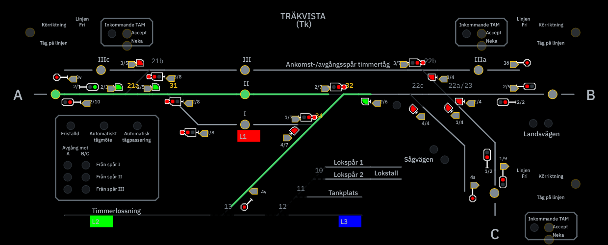

# Träkvista i cda-tkl · kopian körs, och jämförelsen med Charlottendal

17 oktober 2026. Fortsättning på [förstudien](trakvista-forstudie.md). Underlag: Bennys `Trakvista.xml` (JMRI 5.10.0) och
hans 38 CSV-tabeller (`Tk-csvfiler.zip`), båda i `stations/trakvista/`.

## Kort svar

Ja, cda-tkl går att kopiera och köra som Träkvista. Kopian är branchen `claude/trakvista-station-config-3aacbi`: den är
hela cda-tkl, skild från main och därmed från webbdriften på Render. Träkvista körs där med samma kärna, samma
anläggningssimulator och samma panel som Charlottendal. Alla 27 huvudtågvägar och 30 växeltågvägar läggs, klareras och
löses upp efter tågets passage, både i proven och över den riktiga servern med simulerad LocoNet. Charlottendal fungerar
som förut på samma branch, och alla Charlottendals genererade filer är oförändrade.

Jämförelsen talar för en gemensam plattform: en motor och en stationskatalog per station, inte två kopior. Det som
behövde ändras i den delade koden för att få Träkvista att köra var litet och gällde sådant som Charlottendal inte har
(korsningsväxel, lodrät linje, egna växlingsknappar, lokalt styrda spår). Det stationsbundna sitter i källorna och i de
handskrivna Charlottendal-funktionerna, inte i kärnan.

## Starta Träkvista

```sh
npm run start:trakvista          # TKL och anläggningen för Träkvista, på de vanliga portarna 8910–8912
npm run import:trakvista         # återskapa Träkvistas filer ur Trakvista.xml och CSV-tabellerna
npm run verify:trakvista         # kontrollera att de genererade filerna är aktuella
node --test test/trakvista.test.mjs
```

Stationen väljs med `CHARLOTTENDAL_STATION=trakvista`; utan den startar Charlottendal som förut. Träkvistas driftdata
ligger i `var/trakvista/`, så två stationers lås blandas aldrig. Kör inte båda samtidigt på samma portar.



Bilden: A → Spår II och växeltågvägen 2/6 → 4v lagda genom att klicka i panelen; 4v står före växel 13 efter Bennys rättelse. Lokspåren, Tankplatsen och
Timmerlossningen är ritade ofyllda, som i Bennys panel.

## Vad som gjordes

| Del | Fil | Vad |
|---|---|---|
| Spårplan | `scripts/import-layout.py` | JMRI:s LayoutEditor till panel.json, med korsningsväxlar. Ger exakt Charlottendals panel.json (`npm run verify:layout`). |
| Regler | `scripts/import-logixng.py` | Huvud- och växeltågvägar, NX-par, ankarpunkter, växelben och spårledningar ur LogixNG-träden. Blocklistorna i CSV-tabellerna som kontroll. |
| Profil | `scripts/make-station-profile.mjs` | Driftprofil och fältprofil med samma bibliotek som Charlottendals generator. |
| Stationsfil | `stations/trakvista/station.json` | Knapp → spår, linjerna A, B, C, lodrät riktning, lokala växlar, panelens stil. |
| Stationsval | `src/station.mjs` | `CHARLOTTENDAL_STATION`, stationens data och driftdatakatalog. |
| Kärnan | `src/topology.mjs`, `src/route-policy.mjs`, `src/exit-route.mjs`, `src/train-tracking.mjs` | Dubbel korsningsväxel och riktning på lodrätt spår. |
| Panelen | `public/app.js` m.fl. | Korsningsväxeln, ingen vändskiva, vtv-knapparna, ofyllda lokala spår, stationens namn. |
| Prov | `test/trakvista.test.mjs` | Tio prov, bland annat alla 57 tågvägar mot simulatorn. |

Ändringen i den delade koden är ungefär 140 rader i 15 filer. De nya generatorerna är cirka 380 rader.

## Jämförelse

| | Charlottendal | Träkvista |
|---|---|---|
| JMRI | 5.8, Logix: 25 grupper, 1 377 conditionals | 5.10, LogixNG: 24 grupper, 339 ConditionalNG, 13 moduler, 38 CSV-tabeller |
| Externa Jython-skript | 12, saknas | 5, saknas (RemoteControl, BlockSignaling, TamSignaling, CheckMqtt, Automaten) |
| Panel | 2182 × 1320, 274 segment | 976 × 412, 83 segment |
| Växlar | 49, kompisväxlar, 3 spårkorsningar, vändskiva | 13: 9 på LocoNet, 4 interna (lokala), en dubbel korsningsväxel |
| Huvudtågvägar | 210 | 27 |
| Växeltågvägar | 130, 15 undantagna | 30, inga undantagna |
| Signaler | 66, varav 13 utan utgång, bildsats mod59 | 25, alla med utgång, mod68 eller mod59 efter panelmodell |
| Spårledningar | 197, varav 162 med ingång | 36, varav 25 med ingång |
| Linjer | 7 riktade spår (dubbelspår) | 3 enkelspår med körriktning och TAM |
| Växelns återrapport | Växelrapport B1 | Två sensorer per växel (TWOSENSOR) |
| Lokal styrning | Hela stationen lokal eller fjärr | Per spår: ofyllda spår bara lokalt |
| Växling startas | Från signalen | Med egna vtv-knappar vid signalen |
| Grannarna | TrainMeet | MQTT och konfigurationsserver |
| Egna funktioner | Spår 6, rangerbangården, programmeringsspåret, V1–V4, vändskivan | Timmerspår, lokstall, automatiskt tågmöte och tågpassering |

## Det som är gemensamt

Kärnan, LocoNet-protokollet, förbindelsen, anläggningssimulatorn, spårgrafen, vägvalet, signalplanen, frigivningen,
panelens ritning och manöver, TrainMeet, Stream Deck, tidtabellen, användarna och installationen. Allt detta körde
Träkvista utan stationsspecifik kod, sedan korsningsväxeln och den lodräta riktningen fanns.

## Det som är stationens eget

- **Källan och importören.** Charlottendal har Logix och Träkvista LogixNG. Importörerna skriver samma kontrakt
  (`operations-source.json`), så resten av kedjan är gemensam. Bennys andra stationer (Bilbo) har troligen samma
  LogixNG-mall och kan använda Träkvistas importör.
- **Stationsfilen.** Knapparnas spår, linjerna, riktningen på lodrätt spår, lokala växlar och panelens stil.
- **Charlottendals handskrivna funktioner.** Spår 6, rangerbangården, programmeringsspåret, V1–V4 och automatens
  spårordning ligger kvar i koden och gäller bara Charlottendal. De bör flyttas till stationsfilen eller egna moduler.

## Bennys svar 17 oktober och vad som ändrades

| Fråga | Bennys svar | I TKL |
|---|---|---|
| 1. Jython-skripten | Bifogade | Sparade i `stations/trakvista/jython/` som källa. De körs inte; se nästa avsnitt. |
| 2. Växlarnas återrapport | Motorerna har inbyggda lägesgivare; alla är inte inställda i JMRI | Kärnan läser läget från två givare per växel (`feedbackSensors`), tagna efter namn: vx<nr>-t avvikande, vx<nr>-c rakt. Nio växlar har givare. Vx21a saknar givare i XML och väntar på växelrapport. |
| 3. Tabellen 23-37.csv | Troligen kopieringsfel | Står kvar som känt fel i provet. |
| 4. Växel 13 och signal 4v | 13 och L2 ska inte vara med i tågvägen; 4v ska stå före växel 13. Lokala växlar läggs om elektriskt på plats och har givare | Rättelsen i `station.json` flyttar 4v och tvs4v till växel 13:s ben mot diagonalen. 2/6 → 4v går nu över S32, S34 och S4/7. Lokala växlar läggs aldrig av TKL. |
| 5. De lokala spåren | Listan stämmer | Oförändrad. |
| 6. Linjerna | Konfigurationsservern är ersatt av TrainMeet; A, B och C är med när de har en anslutning, C hade ingen | Linjerna i stationsfilen hämtar sin anslutning från TrainMeet. Kopplingen till panelen återstår. |
| 7. Bildsatserna | mod59 för relästyrda paneler, mod68 för skärm; båda finns i JMRI | Bennys panel växlar mellan mod68 (ljus) och mod59 (mörk). TKL:s panel är mörk och motsvarar hans mod59-modell, så mod59 används. |

Växelrapporten via givare gäller bara stationer vars profil anger `feedbackSensors`; Charlottendal är oförändrat. En order
till en växel som redan ligger rätt ändrar inga givare, så kärnan räknar läget som bekräftat direkt när båda givarna
visat det sedan anslutningen. Simulatorn gör som motorerna: den svarar med givarna och tiger när växeln redan ligger rätt.

## Bennys skript

| Skript | Vad det gör | Motsvarighet i TKL |
|---|---|---|
| TamSignaling.py | Klarering (TAM) med grannarna över MQTT: begär, godkänn, neka, återta, körriktning | Klareringen genom TrainMeet, som TKL redan har |
| BlockSignaling.py | Linjeblockering över MQTT: signaler, block och trafikriktning mot grannarna | Tåg på linjen och linjeläget från TrainMeet |
| RemoteControl.py | Fjärrstyrning: en fjärrnod lägger och återtar tågvägar (htv- och vtv-par) när stationen inte är lokalt betjänad | TKL:s lokal- och fjärrläge; anslutningen till ett fjärrsystem finns inte än |
| Automaten.py | Automatiskt tågmöte: vid en TAM-begäran läggs infarten till spåret i tidtabellen och begäran godkänns, annars nekas den. Tågpassering är inte skriven | TKL:s automat lägger tågvägarna; godkännandet av klareringen behöver kopplas på |
| CheckMqtt.py | Kontrollerar att MQTT-anslutningen finns | Behövs inte |

Konfigurationsserverns exempel i skripten anger A = Bilbo (BLO) och B = Charlottendal (CDA), vilket stämmer med Bennys
skärmbild och med stationsfilen.

## Kvar för Träkvista

1. **Linjerna A, B och C i panelen.** Klareringen och tågen på linjen följer i dag Charlottendals orter (Au, An …).
   Linjerna ska läsas ur stationsfilen och anslutningarna ur TrainMeet, med enkelspår, körriktning och Linjen fri.
2. **Spärr för lokalt styrda spår.** Växlarna är spärrade för TKL, men tågvägar in på lokala spår är inte spärrade i
   fjärrläge. Ingen tågväg går dit i dag.
3. **Givarna på plats.** Vx21a:s givare och de lokala växlarnas givare behöver ställas in och mätas.
4. **Studio.** Studio bygger på Charlottendals källor och är avstängt för Träkvista.
5. **Manöver av enskild växel.** Regeln är härledd ur grafen, inte översatt från gruppen *Spärra växlar*.
6. **Automatiskt tågmöte och Friställd.** Automaten ska godkänna klareringen genom TrainMeet när infarten är lagd.

## Kopia eller plattform

En separat GitHub-kopia går att skapa med ett kommando från branchen, eftersom den har hela historiken. Den här
sessionen kan bara skriva till cda-tkl, så ett nytt förråd behöver skapas av en ägare i beahead-ab.

Rekommendationen är ändå en gemensam plattform. Två kopior skulle dela samma kärna men utvecklas isär; varje rättelse i
kärnan skulle behöva göras två gånger. Den här branchen visar att samma kod bär båda stationerna med ett stationsval.
Nästa steg är att flytta Charlottendals källor till `stations/charlottendal/` och dess handskrivna tabeller till
stationsfilen, och att läsa linjerna ur stationsfilen.
